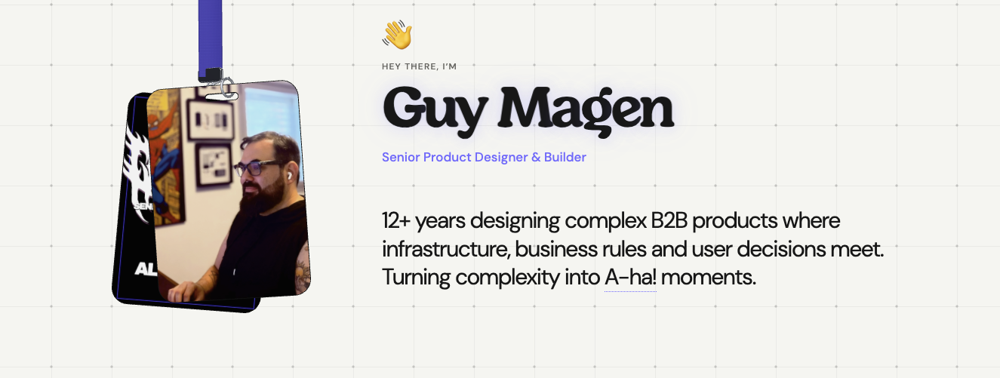

# guymagen.com

The source behind [guymagen.com](https://www.guymagen.com), the portfolio of Guy Magen, a Senior Product Designer and builder with 12+ years of experience designing complex B2B products across SaaS, fintech, cloud cost management and AI tools.

I designed and built the site myself, with AI coding tools as part of the workflow. It is meant to show the work, and also how I work: taking a messy, complex product problem, finding the model underneath it, and turning that into something people can understand and use.

**[View the live site →](https://www.guymagen.com)**

## What's inside

**Case studies**

- **Stigg** · Designing the model behind modern SaaS pricing. How plans, features and entitlements fit together, told through interactive pieces of the product rather than static screenshots.
- **Finout** · Turning cloud cost chaos into one clear picture. Virtual tags, anomaly detection and the "MegaBill" view, rebuilt as small working demos.
- **AI governance** · Exploring clearer controls for Shadow AI and sensitive access. An anonymized design assignment, starting from a detected AI model and showing where it lives, so teams can act on it precisely or block it globally.

**Details worth poking at**

- **Hanging badges in the hero.** Two ID badges on a lanyard, rendered in 3D with their own physics. Drag them, swing them, click to flip both. While the artwork loads they appear pixelated and sharpen once it arrives.
- **Ask about Guy.** A small assistant that answers questions about my work, process and tools, grounded in what is actually on the site.
- **Teara.** A live status card for Teara, the iOS travel app I designed and built independently. It shows the current App Store release from a single source of truth, so every mention on the site stays in sync.

## How it's built

**Design**

- **Figma** for the layouts, case study visuals and the badge artwork, exported straight from the design file into the site
- Case study demos rebuilt as working components rather than screenshots, so visitors can click through the actual interaction patterns

**Front end**

- **React 19** and **TypeScript**, running on **[vinext](https://github.com/cloudflare/vinext)** (a Next.js-style framework on **Vite**)
- **Tailwind CSS** for styling, with hand-written CSS for the layout and motion details
- **Three.js** for the hero badges, with a custom physics step for the strap, clip, rings and card collisions, plus pixelated progressive loading for the artwork
- **Recharts** for the data visuals in the Finout case study, **Lucide** for icons

**Portfolio assistant**

- A **Cloudflare Worker** (`portfolio-agent/`) running **Llama 3.3 70B on Cloudflare Workers AI**, with rate limiting and tests against prompt manipulation
- Answers are grounded in the site's own content, and release questions about Teara read the same status file the site uses

**Shipping and quality**

- **GitHub** for source, **Netlify** for hosting. Every change is reviewed on a staging preview before it goes live.
- **Mixpanel** for product analytics on the live domain only (for example, how visitors interact with the badges)
- **Node's built-in test runner** for the badge physics, analytics events and release status; **ESLint** with accessibility rules (`jsx-a11y`)

**AI in the workflow**

- Built with **OpenAI Codex** and **Claude** as coding partners: I set the direction, design and review every change, and use them to move from idea to working code quickly

## Contact

[guymagen.com](https://www.guymagen.com) · [hi@guymagen.com](mailto:hi@guymagen.com)

Case study content, artwork and photos belong to Guy Magen and are not licensed for reuse. Company names belong to their respective owners. DM Sans is used under the SIL Open Font License (see `public/fonts/`).
